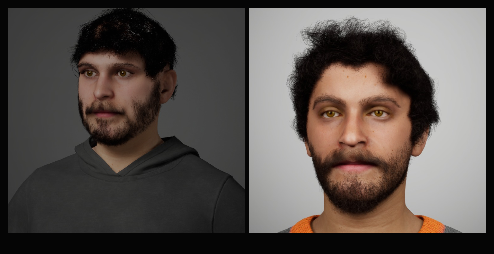
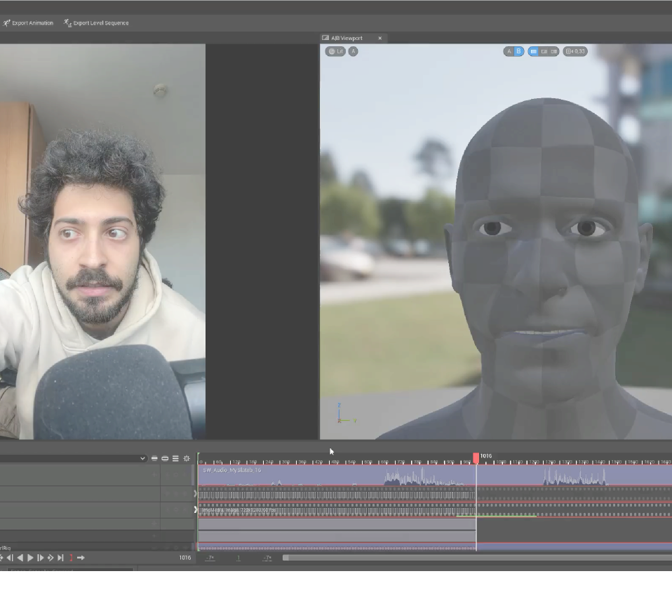

**UE5 MetaHuman Based Cinematics** explores the technical challenges of integrating custom-sculpted faces into the Unreal Engine 5 MetaHuman ecosystem and orchestrating them into a full cinematic sequence using AI motion capture.

## 1. MetaHuman Integration & Grooming

### The Failed FaceBuilder Pipeline
Our initial approach relied on **FaceBuilder** in Blender. While technically sound—using Camera Matching and Texture Projection to "bake" color data into a seamless Albedo UV map—it caused massive bottlenecks in engine. The *MetaHuman Identity* solver attempted to re-fit its skeleton to our custom mesh, softening the hard facial features we extracted. 

Furthermore, custom meshes require custom Grooming (hair/beard). Using Blender's *Hair Curves System* (Modifiers, Strand Steps) gave us incredible artistic control, but the Alembic (.abc) export to Unreal proved fatal. The **Groom Binding broke**: during facial animations, the hair roots lost tracking of the underlying vertices, causing the hair to detach, slide, or explode entirely in 3D space. 

  

    
  

  

    We experienced heavy physics glitches and clipping. Another critical trap was the "Scale Rule": applying the scale in Blender before Alembic export permanently broke Unreal's bi-directional coordinate system.
  

  

    <video src={`${import.meta.env.BASE_URL}/videos/tech-art/a2_hair.mp4`} autoPlay loop muted playsInline style={{ width: '100%', borderRadius: '12px', boxShadow: '0 4px 15px rgba(0,0,0,0.3)' }}></video>
  

  

    <video src={`${import.meta.env.BASE_URL}/videos/tech-art/a2_hair_2.mp4`} autoPlay loop muted playsInline style={{ width: '100%', borderRadius: '12px', boxShadow: '0 4px 15px rgba(0,0,0,0.3)' }}></video>
  

### The Reality Scan Pivot
If we couldn't faithfully recreate other people, we decided to recreate *ourselves*. By using **Reality Scan** combined with the *Mesh to MetaHuman* plugin, we achieved an accurate topological fit while perfectly preserving the complex rigging, skin shaders, and native groom components that make MetaHumans photorealistic. To fix the final groom collision issues, we tweaked the *Strand Size* parameter directly in the Groom settings.

---

## 2. Cinematics & Low-Budget Mocap

The cinematic sequence ("Post Mortem") was orchestrated using a modular **Sequencer Hierarchy** (Master Sequence -> Camera Cuts -> Subsequences). This architecture allowed us to work in parallel on character animations and global editing without causing conflicts.

The visual storytelling was meticulously planned across **7 precise shots**:
1. **Establishing Shot (200mm):** Presenting the exterior setting.
2. **Interior Shot (12mm):** Moving inside to establish the characters' obsession.
3. **MetaHuman Tease (30mm):** A partial reveal of the scientific subject.
4. **Shot/Reverse Shot (50mm):** The dialogue and conflict between Dario and Federico.
5. **The Failed Reveal (85mm):** Showcasing the broken MetaHuman (missing textures, wrong proportions, dead eyes).
6. **Final Confrontation (30mm):** A dolly-in on the characters deciding to end the argument.
7. **Skin Masking:** Final composite details.

Instead of expensive suits, we utilized **Cartwheel** for AI-driven body mocap. We corrected the faulty root motions and foot sliding directly in the sequencer timeline using *Additive Tracks*. The facial acting was captured in real-time via iPhone using **Live Link Face**, injecting authentic micro-expressions and life into our digital avatars.

  <video src={`${import.meta.env.BASE_URL}/videos/tech-art/a3_cartwheel.mp4`} autoPlay loop muted playsInline style={{ width: '100%', borderRadius: '12px', boxShadow: '0 4px 15px rgba(0,0,0,0.3)' }}></video>
  

    
  

---

## 📐 MetaHuman & Cinematics Pipeline Architecture

  

    <svg width="14" height="14" viewBox="0 0 24 24" fill="none" stroke="currentColor" stroke-width="2.5"><polygon points="12 2 2 7 12 12 22 7 12 2"></polygon><polyline points="2 17 12 22 22 17"></polyline><polyline points="2 12 12 17 22 12"></polyline></svg>
    End-to-End MetaHuman & MoCap Architecture
  

  

    

      
STAGE 01

      
Scan & Identity

      
RealityScan photogrammetry of real actors to Mesh-to-MetaHuman fitting, preserving skin and facial bone structures.

    

    

      
STAGE 02

      
Blender Hair Groom

      
Hair curves sculpting, modifiers & strand steps. Alembic (.abc) export with strictly unapplied scale.

    

    

      
STAGE 03

      
Groom Binding & Physics

      
UE5 Groom Binding to skeletal mesh. Custom strand size tuning to prevent vertex decoupling during extreme facial deformation.

    

    

      
STAGE 04

      
Sequencer & MoCap

      
Live Link Face (iPhone) real-time micro-acting blended with Cartwheel AI body mocap across 7 directed camera cuts.

    

  

---

## 🎨 Dedicated Presentation Slides (Slides 14 – 36)

  

    

      Figma Deck · Group 05
      <h4 class="deck-heading">MetaHumans & Cinematics Pipeline</h4>
    

    

      1 / 23
    

  

  

    <button class="deck-nav-btn deck-prev" aria-label="Previous Slide">
      <svg width="22" height="22" viewBox="0 0 24 24" fill="none" stroke="currentColor" stroke-width="2.5"><polyline points="15 18 9 12 15 6"></polyline></svg>
    </button>
    
    <button class="deck-nav-btn deck-next" aria-label="Next Slide">
      <svg width="22" height="22" viewBox="0 0 24 24" fill="none" stroke="currentColor" stroke-width="2.5"><polyline points="9 18 15 12 9 6"></polyline></svg>
    </button>
  

  

    
Slide 1: MetaHumans & AI Cinematics (Cover)

    <a href="https://www.figma.com/deck/Y8w4tPcqatEeqzEAsafK9Z" target="_blank" rel="noopener noreferrer" class="deck-figma-link">
      Open Full Deck on Figma
      <svg width="14" height="14" viewBox="0 0 24 24" fill="none" stroke="currentColor" stroke-width="2.2"><path d="M18 13v6a2 2 0 0 1-2 2H5a2 2 0 0 1-2-2V8a2 2 0 0 1 2-2h6"></path><polyline points="15 3 21 3 21 9"></polyline><line x1="10" y1="14" x2="21" y2="3"></line></svg>
    </a>
  

