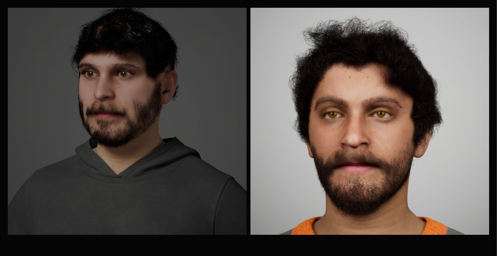
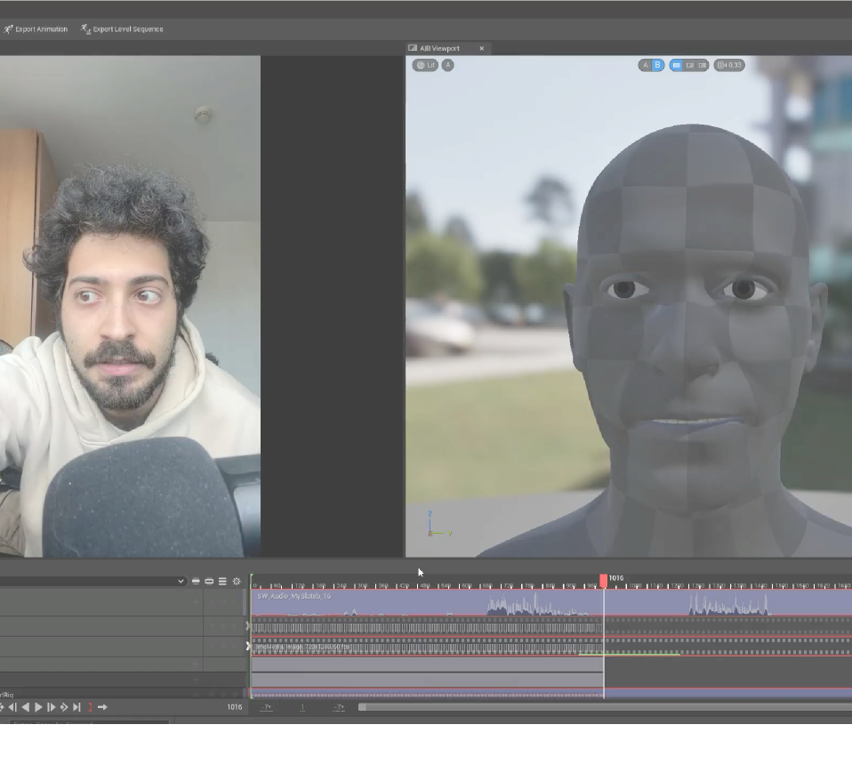

This UE5 Technical Art module ("Post Mortem", built in collaboration with teammate Dario) tackled getting custom facial identities, custom hair grooms, and budget motion capture working together cleanly inside **Unreal Engine 5 Sequencer**.

### 1. Why the First Pipeline Broke: FaceBuilder & Groom Bindings

Our first attempt used **Blender FaceBuilder** with camera matching and texture projection. When imported into UE5, the *MetaHuman Identity* solver re-fitted its base topology over the custom sculpt, flattening distinct facial features.

Custom hair built with Blender's *Hair Curves System* and exported via Alembic (`.abc`) also failed in-engine:

- **Broken Groom Binding:** During facial deformation, hair roots lost tracking against the skeletal mesh and clipped or detached across the face.
- **Coordinate Scale Trap:** Applying object scale in Blender prior to Alembic export corrupted UE5's groom binding transform scale during physics evaluation.

  

    
  

  

    Physics jitter and broken Alembic scale bindings during early Blender Hair Curves tests, before adjusting groom binding and switching identity capture workflows.
  

  

    <video src={`${import.meta.env.BASE_URL}/videos/tech-art/a2_hair.mp4`} autoPlay loop muted playsInline style={{ width: '100%', borderRadius: '12px', boxShadow: '0 4px 15px rgba(0,0,0,0.3)' }}></video>
  

  

    <video src={`${import.meta.env.BASE_URL}/videos/tech-art/a2_hair_2.mp4`} autoPlay loop muted playsInline style={{ width: '100%', borderRadius: '12px', boxShadow: '0 4px 15px rgba(0,0,0,0.3)' }}></video>
  

### 2. Pivot to RealityScan + Mesh-to-MetaHuman

Instead of forcing third-party topology, we scanned ourselves with **RealityScan** and ran **Mesh to MetaHuman**. Keeping inside UE5's native rig preserved skin shaders, facial control rigs, and groom bindings; tuning **Strand Size** in the Groom asset stopped the remaining root collisions during dialogue.

### 3. Low-Budget MoCap & Sequencer Assembly

We split the 7-shot sequence (spanning 12mm wide interiors to 200mm exteriors and 85mm close-ups) across modular **Sequencer Subsequences** so animation cleanup and camera cuts stayed independent:
- **Body Motion (`Cartwheel`):** Corrected foot sliding and drifting root motion in Sequencer using *Additive Animation Tracks*.
- **Facial Capture (`Live Link Face`):** Recorded iPhone ARKit blendshapes directly onto the MetaHuman control rig.

  <video src={`${import.meta.env.BASE_URL}/videos/tech-art/a3_cartwheel.mp4`} autoPlay loop muted playsInline style={{ width: '100%', borderRadius: '12px', boxShadow: '0 4px 15px rgba(0,0,0,0.3)' }}></video>
  

    
  

---

## MetaHuman & Cinematics Pipeline Architecture

  

    <svg width="14" height="14" viewBox="0 0 24 24" fill="none" stroke="currentColor" stroke-width="2.5"><polygon points="12 2 2 7 12 12 22 7 12 2"></polygon><polyline points="2 17 12 22 22 17"></polyline><polyline points="2 12 12 17 22 12"></polyline></svg>
    MetaHuman &amp; MoCap Pipeline Architecture
  

  

    

      
STAGE 01

      
Scan &amp; Identity

      
RealityScan photogrammetry of real actors to Mesh-to-MetaHuman fitting, preserving skin and facial bone structures.

    

    

      
STAGE 02

      
Blender Hair Groom

      
Hair curves sculpting, modifiers &amp; strand steps. Alembic (.abc) export with strictly unapplied scale.

    

    

      
STAGE 03

      
Groom Binding &amp; Physics

      
UE5 Groom Binding to skeletal mesh. Custom strand size tuning to prevent vertex decoupling during extreme facial deformation.

    

    

      
STAGE 04

      
Sequencer &amp; MoCap

      
Live Link Face (iPhone) real-time micro-acting blended with Cartwheel AI body mocap across 7 directed camera cuts.

    

  

---

## Dedicated Presentation Slides (Slides 14 – 36)

  

    

      Figma Deck · Group 05
      <h4 class="deck-heading">MetaHumans &amp; Cinematics Pipeline</h4>
    

    

      1 / 23
    

  

  

    <button class="deck-nav-btn deck-prev" aria-label="Previous Slide">
      <svg width="22" height="22" viewBox="0 0 24 24" fill="none" stroke="currentColor" stroke-width="2.5"><polyline points="15 18 9 12 15 6"></polyline></svg>
    </button>
    
    <button class="deck-nav-btn deck-next" aria-label="Next Slide">
      <svg width="22" height="22" viewBox="0 0 24 24" fill="none" stroke="currentColor" stroke-width="2.5"><polyline points="9 18 15 12 9 6"></polyline></svg>
    </button>
  

  

    
Slide 1: MetaHumans &amp; AI Cinematics (Cover)

    <a href="https://www.figma.com/deck/Y8w4tPcqatEeqzEAsafK9Z" target="_blank" rel="noopener noreferrer" class="deck-figma-link">
      Open Full Deck on Figma
      <svg width="14" height="14" viewBox="0 0 24 24" fill="none" stroke="currentColor" stroke-width="2.2"><path d="M18 13v6a2 2 0 0 1-2 2H5a2 2 0 0 1-2-2V8a2 2 0 0 1 2-2h6"></path><polyline points="15 3 21 3 21 9"></polyline><line x1="10" y1="14" x2="21" y2="3"></line></svg>
    </a>
  

