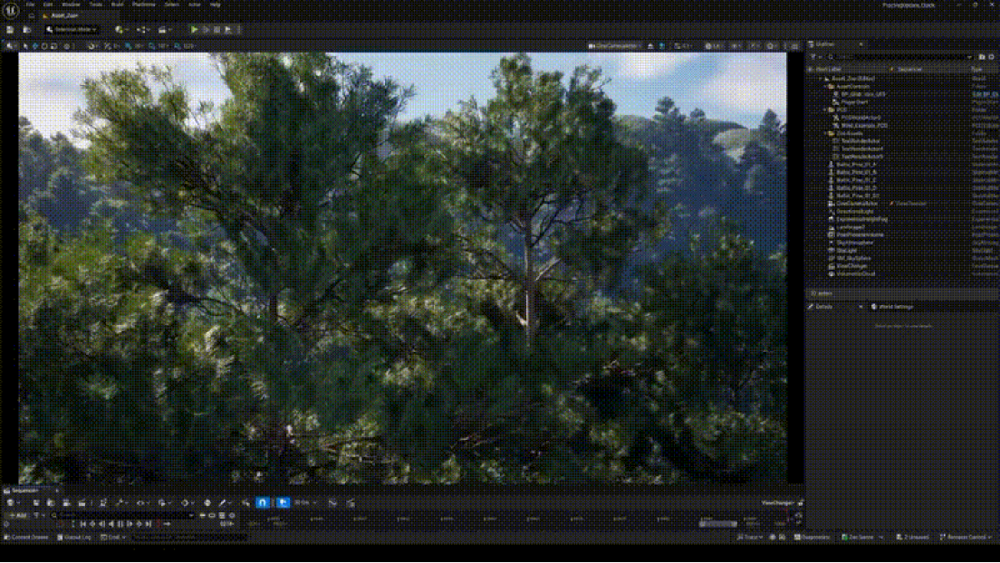

This Unreal Engine 5 Technical Art study focused on building a non-destructive open environment—blending grounded dark-fantasy terrain with stylized foliage and atmospheric lighting—without relying on manual sculpting or hand-placed props.

### 1. Heightmap Ingestion & Rule-Driven Auto-Materials

Instead of sculpting terrain manually, I imported a 16-bit heightmap (generated via Gaea / Motion Forge) into the UE5 Landscape system, calibrating Z-scale ratios so cliff proportions held up cleanly in-engine.

I then authored a **3-rule Landscape Auto-Material**:
- **Slope Masks (World Normal Z):** Blends grass across flat ground and exposes cliff rock automatically past threshold angles.
- **Altitude Masks:** Applies snow transition strictly above a target world Z-height.
- **Macro/Micro Tiling Breakup:** Layers multi-scale noise masks over distance to break visible texture repetition across wide terrain sweeps.

### 2. Spline-Driven PCG & Nanite Foliage

Layout elements (paths, fences, clearing zones, and foliage density) are governed by **PCG graphs reading level splines**. Moving a spline updates surrounding props and vegetation scatter without manual rework.

For tree canopies, standard billboard LODs introduced harsh pop-in and flat shading, so I switched to **Nanite Megaplants** with Subsurface Scattering (SSS) and World Position Offset (WPO) wind shaders.

  

    <video src={`${import.meta.env.BASE_URL}/videos/tech-art/a1_pcg.mp4`} autoPlay loop muted playsInline style={{ width: '100%', borderRadius: '12px', boxShadow: '0 4px 15px rgba(0,0,0,0.3)' }}></video>
  

  

    <video src={`${import.meta.env.BASE_URL}/videos/tech-art/env_a1.mp4`} autoPlay loop muted playsInline style={{ width: '100%', borderRadius: '12px', boxShadow: '0 4px 15px rgba(0,0,0,0.3)' }}></video>
  

  

    
  

### 3. Time-of-Day Integration & Roadblocks

Lighting integrates the **Celestial Night** sky plugin alongside Exponential Height Fog and Volumetric Clouds driven by a shared time variable, paired with a custom **Switching Lights Blueprint** that toggles tagged street lamps automatically as sun elevation drops past dusk.

**Roadblocks Encountered:**
- **Nanite Landscape Instabilities:** Enabling Nanite directly on the full Landscape triggered severe frame drops and editor crashes on this hardware target, forcing a fallback to standard Landscape LOD tessellation paired with Nanite strictly on foliage/meshes.
- **Megaplant PCG Instancing & Mie Scattering:** Megaplant assemblies required custom PCG spawning filters compared to single static meshes, and misconfigured Volumetric Fog Mie Scattering initially flooded scenes with bright white speckling resembling snowfall.

---

## Procedural Architecture & Pipeline Flow

  

    <svg width="14" height="14" viewBox="0 0 24 24" fill="none" stroke="currentColor" stroke-width="2.5"><polygon points="12 2 2 7 12 12 22 7 12 2"></polygon><polyline points="2 17 12 22 22 17"></polyline><polyline points="2 12 12 17 22 12"></polyline></svg>
    Topography &amp; PCG World Building Flow
  

  

    

      
STAGE 01

      
16-bit Heightmaps

      
Gaea / Motion Forge generation. Normalized Z-scale import into UE5 Landscape system.

    

    

      
STAGE 02

      
Auto-Materials

      
Slope normals for rock/cliff exposure; altitude masks for snow; noise masks to kill tiling.

    

    

      
STAGE 03

      
Splines &amp; PCG

      
Curve-driven road &amp; fence placement. PCG grass volume generation &amp; Megaplants foliage.

    

    

      
STAGE 04

      
Celestial Atmosphere

      
Single-variable day/night cycle driving Sun/Moon, Volumetric Clouds, and Tagged Lighting Blueprints.

    

  

---

## Dedicated Presentation Slides (Slides 01 – 13)

  

    

      Figma Deck · Group 05
      <h4 class="deck-heading">Environment Art &amp; World Building</h4>
    

    

      1 / 13
    

  

  

    <button class="deck-nav-btn deck-prev" aria-label="Previous Slide">
      <svg width="22" height="22" viewBox="0 0 24 24" fill="none" stroke="currentColor" stroke-width="2.5"><polyline points="15 18 9 12 15 6"></polyline></svg>
    </button>
    
    <button class="deck-nav-btn deck-next" aria-label="Next Slide">
      <svg width="22" height="22" viewBox="0 0 24 24" fill="none" stroke="currentColor" stroke-width="2.5"><polyline points="9 18 15 12 9 6"></polyline></svg>
    </button>
  

  

    
Slide 1: Environment Art &amp; World Building (Cover)

    <a href="https://www.figma.com/deck/Y8w4tPcqatEeqzEAsafK9Z" target="_blank" rel="noopener noreferrer" class="deck-figma-link">
      Open Full Deck on Figma
      <svg width="14" height="14" viewBox="0 0 24 24" fill="none" stroke="currentColor" stroke-width="2.2"><path d="M18 13v6a2 2 0 0 1-2 2H5a2 2 0 0 1-2-2V8a2 2 0 0 1 2-2h6"></path><polyline points="15 3 21 3 21 9"></polyline><line x1="10" y1="14" x2="21" y2="3"></line></svg>
    </a>
  

