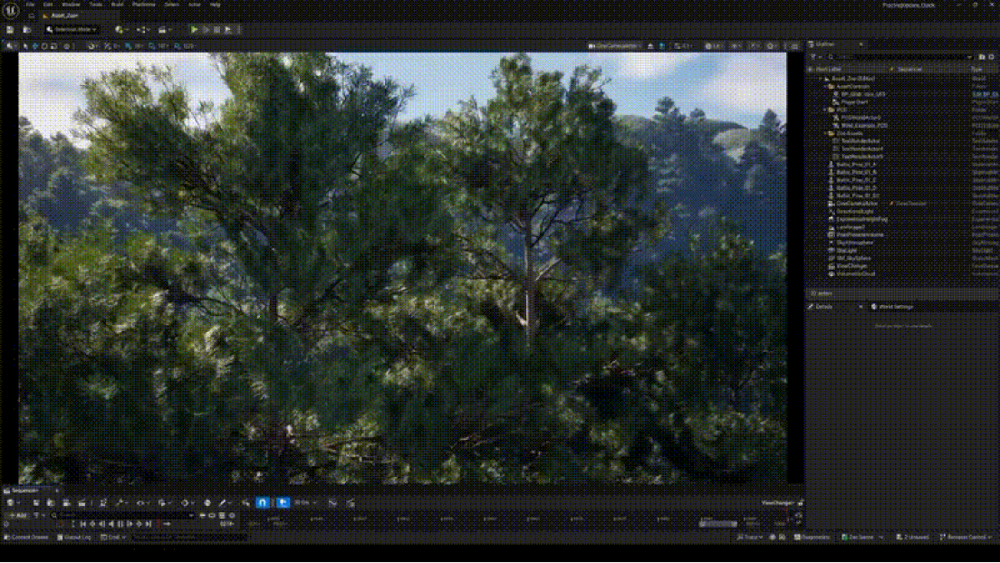

**UE5 Procedural Environments** is a technical exploration demonstrating problem-solving capabilities in Environment Art and non-destructive workflows within Unreal Engine 5. The primary challenge was to create a visual hybrid between the dark fantasy of *The Witcher* and the magical, vibrant aesthetic of *Studio Ghibli*.

### 1. Landscape Auto-Materials & Heightmaps
To build a realistic topography without manual sculpting, we imported a 16-bit Heightmap (generated via Gaea/Motion Forge) directly into the Unreal Engine Landscape Tool. A critical step was correcting the Z-scale proportions to restore the correct height and majesty to the mountains.

Once the landscape geometry was generated, we applied a custom **Auto-Material** based on three core rules:
- **Slope Masks (Z-axis Normals):** Instructs the material to spawn grass on flat surfaces and expose raw rock on steep slopes.
- **Altitude Masks:** A procedural blend that automatically applies snow above a specific Z-height, regardless of the slope.
- **Micro & Macro Variation:** We utilized Noise textures to break the visual repetition (tiling) typical of vast open worlds, maintaining realism from both macro (kilometers away) and micro distances.

### 2. Procedural Ecosystem & PCG
Instead of hand-placing assets, the environment is 100% procedural, allowing the layout to change instantly without manual rework. **Splines govern the Procedural Content Generation (PCG)**—paths, fences, and the garden layout are all derived directly from the geometry rather than being hard-coded.

To overcome the performance limits of traditional billboards, the ecosystem utilizes **Nanite-enabled Megaplants**: photogrammetry-scanned trees with actual geometry for leaves. This eliminates LOD pop-in and allows the **Subsurface Scattering (SSS)** to physically transmit light through the leaves, while the **World Position Offset (WPO)** simulates real-time procedural wind.

  

    <video src={`${import.meta.env.BASE_URL}/videos/tech-art/a1_pcg.mp4`} autoPlay loop muted playsInline style={{ width: '100%', borderRadius: '12px', boxShadow: '0 4px 15px rgba(0,0,0,0.3)' }}></video>
  

  

    <video src={`${import.meta.env.BASE_URL}/videos/tech-art/env_a1.mp4`} autoPlay loop muted playsInline style={{ width: '100%', borderRadius: '12px', boxShadow: '0 4px 15px rgba(0,0,0,0.3)' }}></video>
  

  

    
  

### 3. Dynamic Day/Night Cycle
The lighting is managed by the **Celestial Night** system, a unified ecosystem controlled by a single "time" variable. It physically calculates the position of the sun, moon phases, and stars natively, driving the *Exponential Height Fog* and *Volumetric Clouds* to generate dynamic God Rays. 

Crucially, the global color temperature (PBR) is recalculated in real-time for fluid transitions from dawn to dusk. To handle artificial lighting, we engineered a custom **Switching Lights Blueprint**: it listens to the time variable and uses a "Tag" system to procedurally turn on the level's streetlights when the sun sets.

### Technical Roadblocks
Developing this ecosystem came with heavy technical hurdles. Enabling Nanite on the Landscape initially caused severe framerate drops and continuous engine crashes. Integrating the Megaplants required a vastly different PCG instantiation logic compared to standard meshes, and configuring the atmospheric *Mie Scattering* accidentally caused a visual bug that looked like snow.

---

## 📐 Procedural Architecture & Pipeline Flow

  

    <svg width="14" height="14" viewBox="0 0 24 24" fill="none" stroke="currentColor" stroke-width="2.5"><polygon points="12 2 2 7 12 12 22 7 12 2"></polygon><polyline points="2 17 12 22 22 17"></polyline><polyline points="2 12 12 17 22 12"></polyline></svg>
    Topography & PCG World Building Flow
  

  

    

      
STAGE 01

      
16-bit Heightmaps

      
Gaea / Motion Forge generation. Normalized Z-scale import into UE5 Landscape system.

    

    

      
STAGE 02

      
Auto-Materials

      
Slope normals for rock/cliff exposure; altitude masks for snow; noise masks to kill tiling.

    

    

      
STAGE 03

      
Splines & PCG

      
Curve-driven road & fence placement. PCG grass volume generation & Megaplants foliage.

    

    

      
STAGE 04

      
Celestial Atmosphere

      
Single-variable day/night cycle driving Sun/Moon, Volumetric Clouds, and Tagged Lighting Blueprints.

    

  

---

## 🎨 Dedicated Presentation Slides (Slides 01 – 13)

  

    

      Figma Deck · Group 05
      <h4 class="deck-heading">Environment Art & World Building</h4>
    

    

      1 / 13
    

  

  

    <button class="deck-nav-btn deck-prev" aria-label="Previous Slide">
      <svg width="22" height="22" viewBox="0 0 24 24" fill="none" stroke="currentColor" stroke-width="2.5"><polyline points="15 18 9 12 15 6"></polyline></svg>
    </button>
    
    <button class="deck-nav-btn deck-next" aria-label="Next Slide">
      <svg width="22" height="22" viewBox="0 0 24 24" fill="none" stroke="currentColor" stroke-width="2.5"><polyline points="9 18 15 12 9 6"></polyline></svg>
    </button>
  

  

    
Slide 1: Environment Art & World Building (Cover)

    <a href="https://www.figma.com/deck/Y8w4tPcqatEeqzEAsafK9Z" target="_blank" rel="noopener noreferrer" class="deck-figma-link">
      Open Full Deck on Figma
      <svg width="14" height="14" viewBox="0 0 24 24" fill="none" stroke="currentColor" stroke-width="2.2"><path d="M18 13v6a2 2 0 0 1-2 2H5a2 2 0 0 1-2-2V8a2 2 0 0 1 2-2h6"></path><polyline points="15 3 21 3 21 9"></polyline><line x1="10" y1="14" x2="21" y2="3"></line></svg>
    </a>
  

