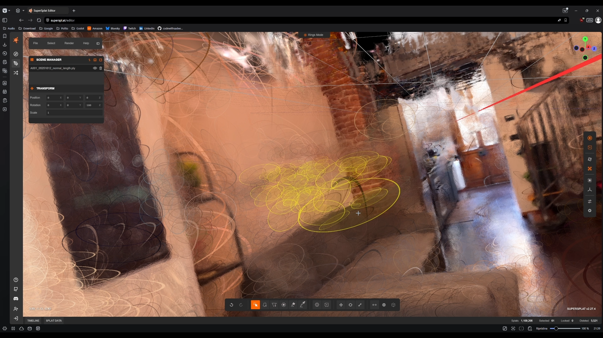
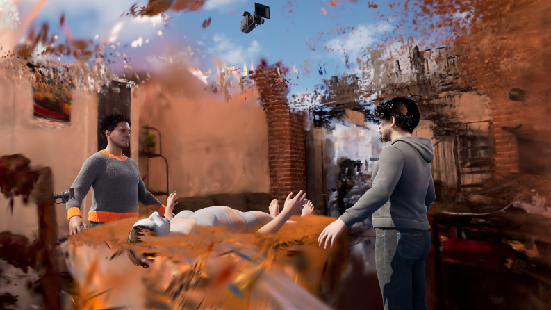

**Gaussian Splats, Photogrammetry and Nerfs Trials** is an exploration of extracting high-fidelity 3D data from 2D videos, comparing traditional photogrammetry with modern neural rendering techniques like NeRFs and Gaussian Splatting.

### 1. Photogrammetry (COLMAP)
Extracting 3D data from video required strict photographic rules. Our "golden rules" were: 
* **No Stabilization**: the camera must be "pure" to avoid confusing the algorithms.
* **Chest Height**: camera facing forward to maintain a constant perspective.
* **Crab Walk**: moving around the perimeter of the room first, followed by three slow 360° pans from the center.

Processing 4500 frames through **COLMAP** locally led to a 10-hour failure due to non-convergent algorithms. We bypassed this by scripting an *FFmpeg* batch to sample frames (1 out of 7), and running COLMAP fully automated via CLI.

  

    <video src={`${import.meta.env.BASE_URL}/videos/tech-art/a4_house.mp4`} autoPlay loop muted playsInline style={{ width: '100%', borderRadius: '12px', boxShadow: '0 4px 15px rgba(0,0,0,0.3)' }}></video>
  

  

    
  

### 2. Local vs Cloud Gaussian Splatting
We compared **NeRF** (which suffered from "melted wax" artifacts and floaters) against **Gaussian Splatting**. 

To generate Splats locally, we used **XScene**, a plugin for Unreal Engine 5.5. While it offered complete privacy and process customization without web waitlists, the performance was lacking. After 4 hours of elaboration on an RTX 4070, the resulting mesh was nearly unreadable, heavily corrupted, and impossible to clean up effectively.

As a post-mortem pivot, we tested AI Cloud tools like **Luma** and **Vid2Scene**. Despite having to wait in server queues (taking up to two days), the final `.ply` point clouds worked flawlessly *out-of-the-box* via NanoGS plugins, delivering an incredibly clean and faithful environment reconstruction compared to the local XScene attempt.

  

    
  

---

## 📐 Photogrammetry & 3DGS Reconstruction Pipeline

  

    <svg width="14" height="14" viewBox="0 0 24 24" fill="none" stroke="currentColor" stroke-width="2.5"><polygon points="12 2 2 7 12 12 22 7 12 2"></polygon><polyline points="2 17 12 22 22 17"></polyline><polyline points="2 12 12 17 22 12"></polyline></svg>
    Spatial Reconstruction Architecture
  

  

    

      
STAGE 01

      
Video Capture Rules

      
Chest height, forward-facing, zero EIS stabilization, outer crab walk + triple 360° inner core pans.

    

    

      
STAGE 02

      
Frame Sampling & SfM

      
FFmpeg 1-in-7 frame downsampling. COLMAP CLI structure-from-motion sparse point cloud solving.

    

    

      
STAGE 03

      
NeRF vs 3DGS

      
Tested NeRF (melted wax artifacts) vs 3D Gaussian Splatting with progressive ellipsoid densification.

    

    

      
STAGE 04

      
UE5 Runtime

      
Post-mortem pivot from local XScene to Cloud AI (Luma/Vid2Scene) delivering clean .ply point clouds via NanoGS.

    

  

---

## 🎨 Dedicated Presentation Slides (Slides 37 – 56)

  

    

      Figma Deck · Group 05
      <h4 class="deck-heading">Reality Capture & Gaussian Splatting</h4>
    

    

      1 / 20
    

  

  

    <button class="deck-nav-btn deck-prev" aria-label="Previous Slide">
      <svg width="22" height="22" viewBox="0 0 24 24" fill="none" stroke="currentColor" stroke-width="2.5"><polyline points="15 18 9 12 15 6"></polyline></svg>
    </button>
    
    <button class="deck-nav-btn deck-next" aria-label="Next Slide">
      <svg width="22" height="22" viewBox="0 0 24 24" fill="none" stroke="currentColor" stroke-width="2.5"><polyline points="9 18 15 12 9 6"></polyline></svg>
    </button>
  

  

    
Slide 1: Reality Capture & 3D Gaussian Splatting (Cover)

    <a href="https://www.figma.com/deck/Y8w4tPcqatEeqzEAsafK9Z" target="_blank" rel="noopener noreferrer" class="deck-figma-link">
      Open Full Deck on Figma
      <svg width="14" height="14" viewBox="0 0 24 24" fill="none" stroke="currentColor" stroke-width="2.2"><path d="M18 13v6a2 2 0 0 1-2 2H5a2 2 0 0 1-2-2V8a2 2 0 0 1 2-2h6"></path><polyline points="15 3 21 3 21 9"></polyline><line x1="10" y1="14" x2="21" y2="3"></line></svg>
    </a>
  

